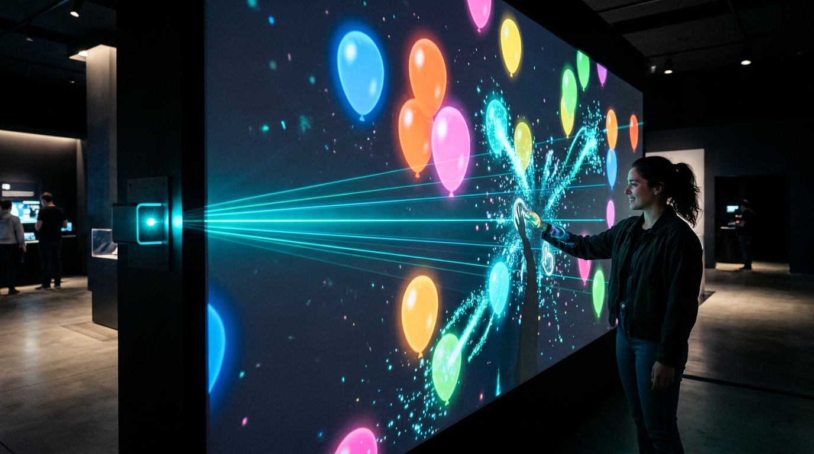
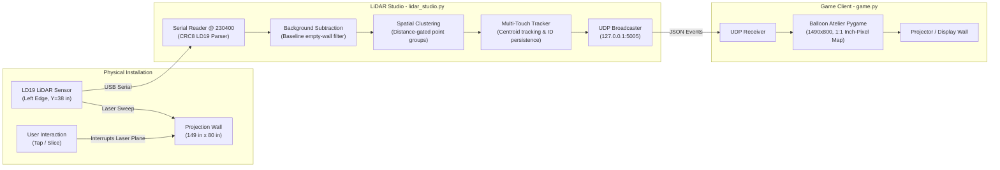

# 🎈 LiDAR Interactive Touch Wall

[](https://www.python.org/)
[](https://www.pygame.org/)
[](https://www.waveshare.com/wiki/DTOF_LIDAR_LD19)
[](LICENSE)



**LiDAR Interactive Touch Wall** transforms any standard projection surface or flat wall into a high-speed, multi-touch interactive gaming arena. Powered by a single side-mounted **LD19 TOF LiDAR**, the system detects touches and fast swipes in real-time and streams low-latency UDP touch events to interactive client applications.

Included in this repository is **Balloon Atelier**, a vibrant Pygame that allows users to tap and slice floating balloons with natural hands and gestures.

---

## 🏛️ System Architecture



---

## 📐 1:1 Physical Coordinate Mapping

The entire system relies on a unified, direct 1:1 scale mapping between the real world wall and screen pixels, avoiding complex distortion matrices:

* **Scale:** $1\text{ inch} = 10\text{ pixels}$ (`PPI = 10`)
* **Total Wall Dimensions:** $149'' \text{ wide} \times 80'' \text{ tall}$ $\rightarrow$ **$1490 \times 800\text{ px}$**
* **Dead Zones:** $4''$ left buffer and $4''$ right buffer ($8''$ total edge margin)
* **Playable Active Area:** $141''$ horizontal active zone ($x = 4'' \dots 145''$)
* **LiDAR Sensor Position:** Mounted directly on the left wall edge ($x = 0$), $38''$ down from the top edge.

```text
 0" (Left Edge)                                                              149" (Right Edge)
 ┌─────────┬────────────────────────────────────────────────────────┬─────────┐  0"
 │ 4" DEAD │                  ACTIVE PLAYABLE AREA                  │ 4" DEAD │
 │  ZONE   │                  (141 in x 80 in)                      │  ZONE   │
 │         │                                                        │         │
 │[LiDAR]--┼ - - - - - - Laser Scan Plane - - - - - - - - - - - - - ┼         │ 38" (Sensor Y)
 │         │                                                        │         │
 │         │                                                        │         │
 └─────────┴────────────────────────────────────────────────────────┴─────────┘  80" (Bottom)
 0 px     40 px                                                   1450 px   1490 px
```

---

## ✨ Features

- **High Precision LD19 Driver:** Custom binary serial protocol reader with CRC8 validation operating at 230,400 baud.
- **Intelligent Background Subtraction:** Automatically learns the room baseline on startup or via hotkey (`C`), ignoring stationary obstacles and wall geometry.
- **Dynamic Multi-Touch Tracking:** Clusters laser points within spatial and angular thresholds, smoothing track jitter and maintaining touch ID persistence across frames.
- **Standardized UDP JSON Protocol:** Emits events containing raw millimeters, inches, and normalized ($0.0 \dots 1.0$) coordinates.
- **Interactive Pygame ("Balloon Atelier"):**
  - **Tap-to-Pop:** Instant detection for quick finger or palm presses.
  - **Swipe-to-Slice:** Vector intersection physics allowing multiple balloons to be sliced in a single rapid motion.
  - **Dynamic Combos:** Rapid pops trigger bonus multiplier scores.
  - **Particle Effects:** Physics-based sparks and glowing trails follow each player's hand.
- **Offline Mouse Simulation:** Fully playable and testable using mouse gestures without physical LiDAR hardware connected.

---

## 📡 UDP Network Protocol

`lidar_studio.py` broadcasts touch telemetry to UDP port `5005` on `127.0.0.1`:

```json
{
  "type": "touch_move",
  "id": 1,
  "x_mm": 1845.2,
  "y_mm": 965.2,
  "x_inches": 72.65,
  "y_inches": 38.00,
  "x_norm": 0.486879,
  "y_norm": 0.475000,
  "timestamp": 1729864200.123
}
```

* `type`: `"touch_down"`, `"touch_move"`, or `"touch_up"`
* `id`: Stable integer ID tracking an active hand/contact
* `x_inches`, `y_inches`: Matches exact 1:1 scale used by Pygame
* `x_norm`, `y_norm`: $0.0 \dots 1.0$ normalized to active playable boundary

---

## 🚀 Quickstart & Installation

### 1. Clone the Repository
```bash
git clone https://github.com/Vikramreddy17/lidar-interactive-wall.git
cd lidar-interactive-wall
```

### 2. Install Dependencies
Ensure you have Python 3.8+ installed:
```bash
pip install -r requirements.txt
```

### 3. Running the Server (LiDAR Studio)
Connect your LD19 sensor via USB to your computer, adjust the `PORT` (e.g. `COM7` on Windows or `/dev/ttyUSB0` on Linux) in `lidar_studio.py` if necessary, and launch:
```bash
python lidar_studio.py
```
*Note: Keep the wall clear for 2 seconds on launch so the auto-capture baseline can calibrate.*

### 4. Running the Game (Balloon Atelier)
In a separate terminal, start the interactive game:
```bash
python game.py
```

---

## 🎮 Controls & Hotkeys

### LiDAR Studio (`lidar_studio.py`)
| Key | Action |
|:---|:---|
| `D` | Toggle **Mouse Demo Mode** (simulates touch without LiDAR) |
| `C` | **Recapture Baseline** (wall must be empty) |
| `H` | Toggle diagnostic HUD & sensor metrics |
| `G` | Toggle 10-inch reference grid |
| `M` | Mirror Y-axis |
| `↑` / `↓` | Fine-tune sensor vertical position ($\pm 0.5''$) |
| `←` / `→` | Fine-tune forward angle orientation ($\pm 1^\circ$) |
| `R` | Reconnect serial port |
| `F11` | Toggle fullscreen |
| `ESC` | Exit fullscreen |

### Balloon Atelier Game (`game.py`)
| Key / Input | Action |
|:---|:---|
| `Left Click / Drag` | Mouse tap or slice (for testing without sensor) |
| `G` | Toggle 10-inch overlay alignment grid |
| `F11` | Toggle fullscreen (borderless scaled display) |
| `R` | Reset score, combo, and clear all active balloons |
| `ESC` | Exit game |

---

## 🛠️ Calibration Tips

1. **Sensor Alignment:** Mount the LD19 LiDAR flush against the left boundary of the interactive wall so the rotating laser sweeps parallel to the wall surface at a distance of approximately 1 to 2 inches away from the surface.
2. **Empty Baseline Capture:** Ensure no people or objects are in front of the wall when launching `lidar_studio.py` (or press `C` to re-capture).
3. **Dead Zones:** The 4-inch side dead zones prevent clipping artifacts and spurious edge reflections from triggering unwanted touch events.

---

## 📄 License

This project is licensed under the MIT License - see the [LICENSE](LICENSE) file for details.
